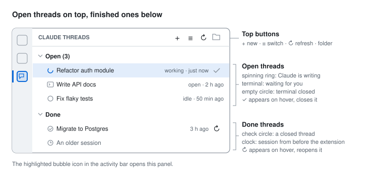
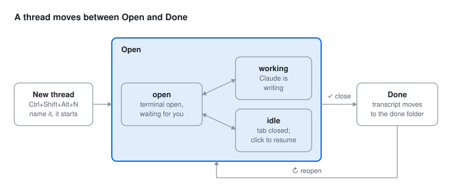

# Claude Threads by Guven

Manage several [Claude Code](https://docs.anthropic.com/en/docs/claude-code) terminal sessions inside VS Code as **threads**: open a new one with a shortcut, switch between them from one list, close the finished ones. Every project keeps an **Open / Done** record with readable Markdown transcripts.

> Unofficial community project. Not affiliated with, endorsed by or sponsored by Anthropic. "Claude" and "Claude Code" are trademarks of Anthropic, PBC.

**Docs:** [User guide (English)](docs/GUIDE.md) · [Kullanım kılavuzu (Türkçe)](docs/KILAVUZ.md)

<p align="center"></p>

## Features

- **Side panel** with two groups, *Open* and *Done*. Each row shows whether Claude is working, waiting for you, or idle.
- **New thread** (`Ctrl+Shift+Alt+N`): asks for a name and starts `claude` in its own terminal tab.
- **Switch** (`Ctrl+Shift+Alt+T`): one quick-pick box for every thread. A running thread is brought forward; a closed one resumes with `claude --resume`.
- **Close** (`Ctrl+Shift+Alt+W` or ✓ on the row): the terminal closes and the thread moves to *Done*. Reopen it any time with ↻.
- **Transcripts**: a readable `.md` copy of each thread is kept in the project, updated a few seconds after every reply.
- **English and Turkish** interface (follows VS Code, or set `claudeThreads.language`).

On macOS the shortcuts use `Cmd` instead of `Ctrl`.

<p align="center"></p>

## Requirements

- VS Code 1.90 or newer
- [Claude Code](https://docs.anthropic.com/en/docs/claude-code) installed, with `claude` on your `PATH` (or set `claudeThreads.claudeCommand`)

## Install

Not on the Marketplace yet. Build and install from source:

```bash
git clone https://github.com/MyNameStartsWithG/Claude-Threads-by-Guven.git
cd Claude-Threads-by-Guven
npx @vscode/vsce package
code --install-extension claude-threads-by-guven-*.vsix
```

Then run **Developer: Reload Window** and open a project folder. There is no build step; to hack on it, open the folder in VS Code and press `F5`.

## How it works

Claude Code stores every session as a `.jsonl` file under `~/.claude/projects/<project>/`. The extension only **reads** those files to list sessions, detect activity and write transcripts; it never modifies them, so `claude --resume` keeps working even if you uninstall the extension.

Its own records live in the project:

```
.claude-threads/
  threads.json   which threads are open or done, and their names
  open/          transcripts of open threads (.md)
  done/          transcripts of closed threads (.md)
```

(With the Turkish interface a new project gets `durum.json`, `acik/` and `biten/`. Folder names are fixed per project once created.)

## Privacy

- Transcripts contain your **full conversations**. If the project is a git repository, add `.claude-threads/` to `.gitignore` unless you really want them committed.
- The extension makes **no network requests** and collects no telemetry.

## Limitations

- The session `.jsonl` format is internal to Claude Code and undocumented. A Claude Code update may change it; names or transcripts could then be incomplete until the extension is updated.
- Developed and tested on Windows. macOS and Linux should work but are untested — reports welcome.
- Only the first folder of a multi-root workspace is used.

## Settings

| Setting | Default | |
|---|---|---|
| `claudeThreads.language` | `auto` | `auto`, `en` or `tr` |
| `claudeThreads.terminalLocation` | `editor` | `panel` opens threads in the bottom terminal panel |
| `claudeThreads.extraArgs` | *(empty)* | added to every `claude` command, e.g. `--permission-mode auto` |
| `claudeThreads.claudeCommand` | `claude` | full path if `claude` is not on `PATH` |
| `claudeThreads.saveFolder` | `.claude-threads` | |
| `claudeThreads.showUntracked` | `true` | list older sessions (started outside the extension) under *Done* |

## Contributing

Issues and pull requests are welcome. The guide figures are generated: edit `docs/images/build.js` and run `node docs/images/build.js`.

## License

[MIT](LICENSE)
