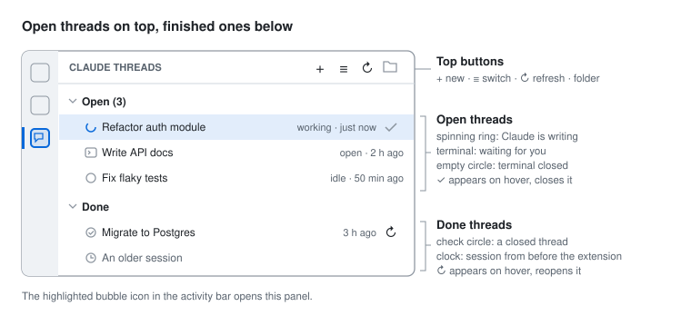
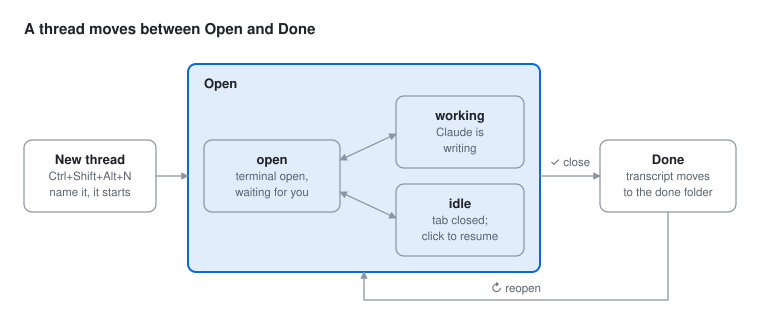
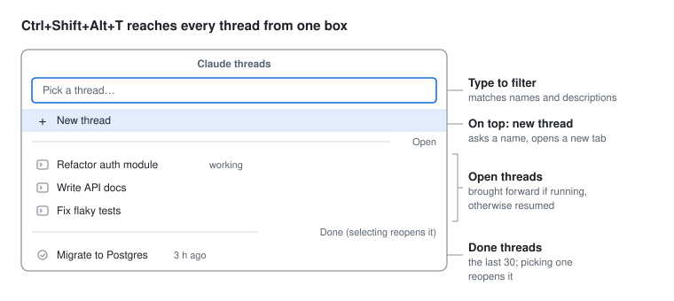
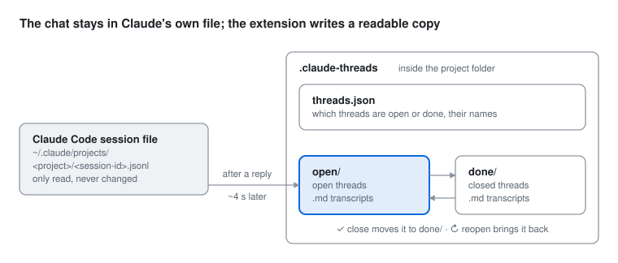

# Claude Threads — User guide

[Türkçe](KILAVUZ.md)

Claude Threads lets you run several Claude Code conversations (threads) in VS Code terminals and open, switch and close them from a single list.

## Getting started

1. Install the extension (see the [README](../README.md#install)) and run **Developer: Reload Window** (`Ctrl+Shift+P`).
2. Open a project folder. Threads are listed per folder; with no folder open the list stays empty.
3. Click the **speech-bubble** icon in the activity bar on the left. The **Claude Threads** panel opens.
4. Press `Ctrl+Shift+Alt+N`, type a name, press Enter. Your first thread starts.

## The side panel

The panel has two groups: **Open** (ongoing threads, expanded by default) and **Done** (closed ones, collapsed). Each group shows its count. Every row has a name, an icon and a grey description; hover a row to see its first message and session ID.



| Icon | Group | Meaning | Description reads |
|---|---|---|---|
| Spinning ring | Open | Claude is writing a reply (session file changed in the last 8 s) | working · just now |
| Terminal | Open | Terminal is open, Claude is waiting for you | open · 5 min ago |
| Empty circle | Open | Thread is open but its terminal is closed; click to resume | idle · 2 h ago |
| Check circle | Done | Closed with the extension | 3 d ago |
| Clock | Done | An older session started outside the extension | 2 weeks ago |

**Panel buttons** (left to right): **+** new thread · **≡** quick switch · **↻** refresh (the list also refreshes every 3 s) · **folder** opens the save folder in your file manager.

**Row buttons:** hovering an open thread shows **✓**, which closes it. On a done thread it shows **↻**, which reopens it.

**Right-click menu:** Open · Close / Reopen · Rename · Show transcript.

## Everyday use

| Shortcut (macOS: `Cmd` for `Ctrl`) | Action |
|---|---|
| `Ctrl+Shift+Alt+N` | New thread |
| `Ctrl+Shift+Alt+T` | Switch between threads |
| `Ctrl+Shift+Alt+W` | Close the thread in front |



An open thread moves between three states on its own; only ✓ moves it to Done, and ↻ brings it back.

**New thread.** Asks for a name (suggesting the next number, e.g. `Thread 4`). Press Enter and the thread opens in its own terminal tab, named `🧵 Name [first 8 characters of the ID]`, and appears under Open.

**Switching.** Two ways:
- Click an open thread in the list. If its terminal is open it comes forward; otherwise it resumes in a new tab where it left off.
- Press `Ctrl+Shift+Alt+T` for the quick-switch box: *New thread* on top, then open threads, then the last 30 done threads. Type to filter; picking a done thread reopens it.



**Closing.** ✓ on the row, or `Ctrl+Shift+Alt+W`. The terminal closes, the thread moves to Done and its transcript moves to the done folder. If Claude is still writing you are asked first, because closing interrupts the reply. Closing only the terminal tab (its ×) leaves the thread under Open as *idle*.

**Clicking a done thread** does not open a terminal; it shows the conversation's transcript in the Markdown preview. Use ↻ (Reopen) to continue it.

**Renaming.** Right-click → Rename. The name in the list, the transcript file name and (if open) the terminal tab are renamed together. Claude Code's own `/resume` list keeps its own names.

## The save folder

Each project gets a `.claude-threads` folder:



- Transcript files are named `2026-01-31 Name [first 8 characters of the ID].md`. They contain the status, session ID, start and last-activity times, the resume command, and every message from you and Claude; the tools Claude used are summarised in one line under each reply.
- Transcripts of open threads update about 4 seconds after Claude finishes a reply.
- Closing a thread moves its transcript from `open/` to `done/`; reopening moves it back.
- Older sessions started outside the extension get a transcript only when you click them.
- Claude Code's own session files are never modified, so uninstalling the extension loses nothing.

With the Turkish interface a new project uses `durum.json`, `acik/` and `biten/` instead. The names are stored in the state file and stay fixed for that project, so switching language later does not split the records.

If the project is a git repository and you do not want transcripts committed, add `.claude-threads/` to `.gitignore`.

## Settings

Open them with `Ctrl+,` and search for `Claude Threads`.

| Setting | Default | What it does |
|---|---|---|
| Language | `auto` | Panel, messages and transcripts in English or Turkish (`auto` follows VS Code) |
| Terminal Location | `editor` | `editor`: each thread is its own editor tab. `panel`: the bottom terminal panel |
| Extra Args | *(empty)* | Added to every thread, e.g. `--permission-mode auto` |
| Claude Command | `claude` | Command that starts Claude Code |
| Save Folder | `.claude-threads` | The records folder inside the project |
| Show Untracked | on | List sessions started before the extension under Done |

## Troubleshooting

| Problem | Fix |
|---|---|
| No icon in the activity bar | `Ctrl+Shift+X` → `@installed claude threads`, check it is enabled, then **Developer: Reload Window** |
| The list is empty | Open a project folder in VS Code |
| `claude` not found in the terminal | Set Claude Command to the full path of the `claude` executable |
| The same thread opened in two terminals | Close one; two processes writing to one session mix up the conversation |
| Any other error | `Ctrl+Shift+P` → **Developer: Toggle Developer Tools** → Console, look for lines starting with `[claude-threads]` and open an issue |

## Advanced: adopting a terminal you opened by hand

Terminals the extension opens are recognised by the `[id]` at the end of their tab name. A Claude session you started yourself in a terminal can be adopted by adding it to the state file with the shell's process ID:

```json
"<session-id>": { "id": "<session-id>", "ad": "My thread", "durum": "acik", "kabukPid": 12345 }
```

`kabukPid` is the PID of the **shell** that runs `claude` (its parent process). The extension picks up the change automatically and binds that terminal to the thread; the binding is dropped when the terminal closes.
