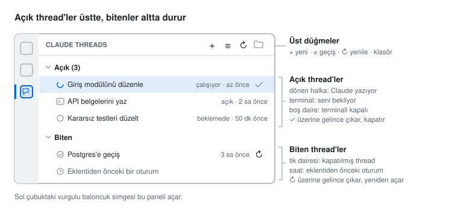
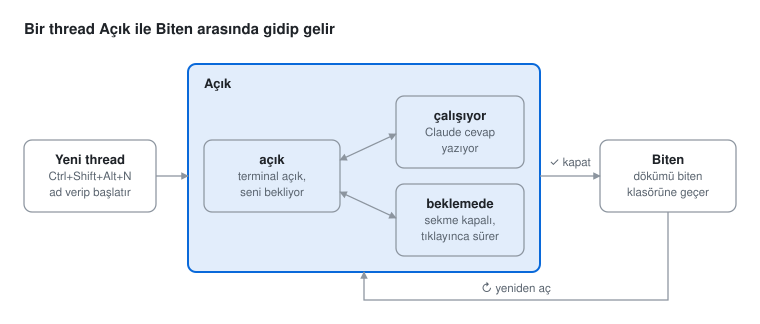
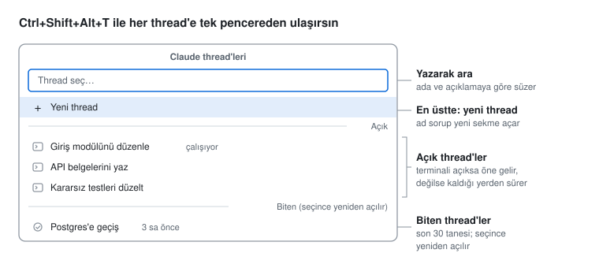
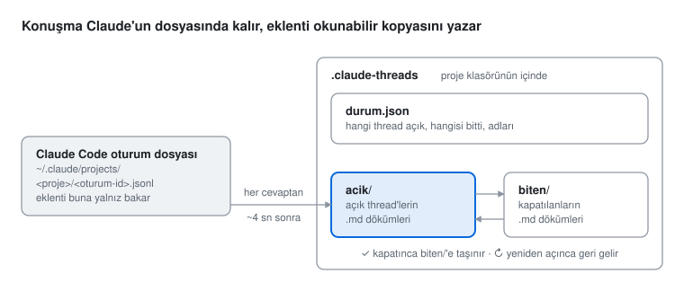

# Claude Threads — Kullanım kılavuzu

[English](GUIDE.md)

Claude Threads, Claude Code'u VS Code terminalinde kullanırken birden fazla konuşmayı (thread) tek bir listeden açıp kapatmanı ve aralarında gezmeni sağlar.

## Başlarken

1. Eklentiyi kur ([README](../README.md#install)) ve `Ctrl+Shift+P` → **Developer: Reload Window** ile pencereyi yenile.
2. Bir proje klasörü aç. Thread'ler açık klasöre göre listelenir; klasör açık değilse liste boş kalır.
3. Sol etkinlik çubuğundaki **baloncuk** simgesine tıkla. **Claude Threads** paneli açılır.
4. İlk thread için `Ctrl+Shift+Alt+N` tuşlarına bas, adını yaz, Enter.

Arayüz VS Code Türkçeyse kendiliğinden Türkçe olur. Değilse ayarlardan **Language** değerini `tr` yap.

## Kenar çubuğu

Panelde iki grup var: **Açık** (devam eden thread'ler, hep açık gelir) ve **Biten** (kapatılanlar, kapalı gelir). Her grubun adında thread sayısı yazar. Her satırda thread'in adı, simgesi ve yanında gri bir açıklama durur; fareyi üstüne getirince ilk mesajı ve oturum ID'si görünür.



| Simge | Grup | Anlamı | Açıklamada yazan |
|---|---|---|---|
| Dönen halka | Açık | Claude şu an cevap yazıyor (son 8 saniyede dosyası değişti) | çalışıyor · az önce |
| Terminal | Açık | Terminali açık, Claude seni bekliyor | açık · 5 dk önce |
| Boş daire | Açık | Thread açık ama terminali kapalı; tıklayınca kaldığı yerden devam eder | beklemede · 2 sa önce |
| Tik dairesi | Biten | Eklentiyle kapatılmış thread | 3 gün önce |
| Saat | Biten | Eklentiden önce açılmış eski oturum | 14 gün önce |

**Panelin üstündeki düğmeler** (soldan sağa): **+** yeni thread · **≡** hızlı geçiş · **↻** yenile (liste zaten 3 saniyede bir tazelenir) · **klasör** kayıt klasörünü dosya yöneticisinde açar.

**Satırdaki düğme:** Açık bir thread'in üzerine gelince **✓** çıkar ve thread'i kapatır. Biten bir thread'de bunun yerine **↻** çıkar ve thread'i yeniden açar.

**Sağ tık menüsü:** Aç · Kapat ya da Yeniden aç · Yeniden adlandır · Dökümü göster.

## Günlük kullanım

| Kısayol (macOS'ta `Ctrl` yerine `Cmd`) | İş |
|---|---|
| `Ctrl+Shift+Alt+N` | Yeni thread |
| `Ctrl+Shift+Alt+T` | Thread'ler arasında geç |
| `Ctrl+Shift+Alt+W` | O an öndeki thread'i kapat |



Açık bir thread kendi içinde üç durum arasında gezer; yalnız ✓ ile kapatınca Biten'e geçer ve ↻ ile geri gelir.

**Yeni thread.** Ad sorar (önerilen ad `Thread 4` gibi sıradaki numara). Enter'a basınca thread kendi terminal sekmesinde açılır ve Açık grubuna eklenir. Sekmenin adı `🧵 Ad [ID'nin ilk 8 hanesi]` biçimindedir.

**Thread'ler arasında geçiş.** İki yol var:
- Listede bir Açık thread'e tıkla. Terminali açıksa öne gelir; kapalıysa yeni bir sekmede kaldığı yerden devam eder.
- `Ctrl+Shift+Alt+T` ile hızlı seçim penceresini aç. En üstte "Yeni thread", sonra Açık thread'ler, en altta son 30 Biten thread durur. Yazarak arayabilirsin; Biten bir thread'i seçmek onu yeniden açar.



**Kapatma.** Satırdaki ✓ ya da `Ctrl+Shift+Alt+W`. Terminal kapanır, thread Biten'e geçer, dökümü biten klasörüne taşınır. Claude o sırada cevap yazıyorsa önce onay ister, çünkü kapatmak cevabı yarıda keser. Terminal sekmesini sadece çarpıyla kapatırsan thread Açık'ta "beklemede" olarak kalır.

**Biten bir thread'e tıklamak** terminal açmaz; konuşmanın okunabilir dökümünü önizlemede gösterir. Devam etmek için ↻ (Yeniden aç) kullan.

**Yeniden adlandırma.** Sağ tık → Yeniden adlandır. Listedeki ad, döküm dosyasının adı ve (açıksa) terminal sekmesinin adı birlikte değişir. Claude Code'un kendi `/resume` listesi kendi adlarını korur.

## Kayıt klasörü

Her proje klasörünün içinde `.claude-threads` adlı bir klasör oluşur:



- Döküm dosyasının adı `2026-01-31 Ad [ID'nin ilk 8 hanesi].md` biçimindedir. İçinde durum, oturum ID'si, başlangıç ve son etkinlik zamanı, devam ettirme komutu ve tüm mesajlar (senin ve Claude'un) yazar; Claude'un kullandığı araçlar her cevabın altında tek satırda özetlenir.
- Açık thread'lerin dökümü, Claude bir cevabı bitirdikten yaklaşık 4 saniye sonra kendiliğinden güncellenir.
- Thread'i kapatınca döküm `acik/`'tan `biten/`'e taşınır; yeniden açınca geri gelir.
- Eklentiden önce açılmış eski oturumların dökümü ancak sen ona tıklayınca yazılır.
- Claude Code'un kendi oturum dosyalarına dokunulmaz. Bu yüzden eklentiyi silsen bile konuşmaların kaybolmaz.

Arayüz İngilizceyken yeni bir proje `threads.json`, `open/` ve `done/` adlarını kullanır. Adlar kayıt dosyasına yazılır ve o proje için sabit kalır; dili sonradan değiştirmek kayıtları bölmez.

Proje git'teyse ve dökümlerin depoya girmesini istemiyorsan `.gitignore` dosyasına `.claude-threads/` satırını ekle.

## Ayarlar

Ayarlara `Ctrl+,` → arama kutusuna `Claude Threads` yazarak ulaşırsın.

| Ayar | Varsayılan | Ne işe yarar |
|---|---|---|
| Language | `auto` | Panel, mesajlar ve dökümler İngilizce ya da Türkçe (`auto` VS Code'u izler) |
| Terminal Location | `editor` | `editor`: her thread editörde ayrı sekme. `panel`: alttaki terminal panelinde |
| Extra Args | boş | Her thread'e eklenen argümanlar, örn. `--permission-mode auto` |
| Claude Command | `claude` | Claude'u başlatan komut |
| Save Folder | `.claude-threads` | Kayıtların proje içindeki klasörü |
| Show Untracked | açık | Eklentiden önceki eski oturumları Biten'de göster |

## Sorun giderme

| Sorun | Çözüm |
|---|---|
| Sol çubukta simge yok | `Ctrl+Shift+X` → `@installed claude threads` ile eklentinin etkin olduğuna bak, sonra **Developer: Reload Window** |
| Liste boş | VS Code'da bir proje klasörü açık olmalı |
| Terminalde `claude` bulunamadı hatası | Claude Command ayarına `claude` programının tam yolunu yaz |
| Aynı thread iki terminalde açıldı | Birini kapat; iki süreç aynı oturuma yazarsa konuşma karışır |
| Başka bir hata | `Ctrl+Shift+P` → **Developer: Toggle Developer Tools** → Console sekmesinde `[claude-threads]` ile başlayan satırlara bak ve bir issue aç |

## İleri düzey: elle açtığın bir terminali bağlamak

Eklentinin açtığı terminaller sekme adının sonundaki `[id]` ile tanınır. Kendin bir terminalde başlattığın Claude oturumunu, kabuğun süreç numarasıyla (PID) kayıt dosyasına ekleyerek bağlayabilirsin:

```json
"<oturum-id>": { "id": "<oturum-id>", "ad": "Thread adım", "durum": "acik", "kabukPid": 12345 }
```

`kabukPid`, `claude`'u çalıştıran **kabuğun** (üst sürecin) PID'idir. Eklenti değişikliği kendiliğinden görür ve o terminali thread'e bağlar; terminal kapanınca bağ silinir.
